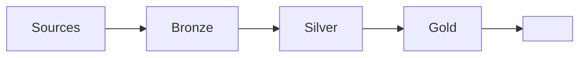

# Spec: <Project name>

## 1. Problem and KPI

- Problem: <...>
- KPI: <metric>, baseline <value>, target <value> by <date>.

## 2. Users

| User  | Need  | How they consume the result |
| ----- | ----- | --------------------------- |
| <...> | <...> | <...>                       |

## 3. Scope

- In: <...>
- Out: <...>

## 4. Data

| Source | Grain | Key   | Frequency | Known quality issues |
| ------ | ----- | ----- | --------- | -------------------- |
| <...>  | <...> | <...> | <...>     | <...>                |

## 5. Architecture

## 6. Acceptance criteria

- [ ] <measurable criterion and the command that proves it>
- [ ] <measurable criterion and the command that proves it>

## 7. Risks and assumptions

- <...>
